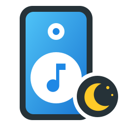
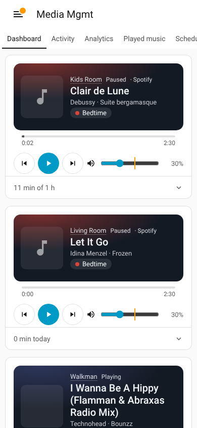
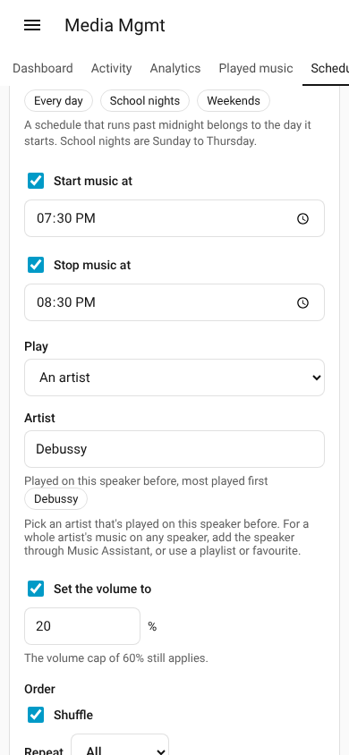

<p align="center"></p>

# Media Mgmt

[](https://hacs.xyz/)
[](https://www.home-assistant.io/)
[](https://github.com/bisman-automations/ha-media-mgmt/releases)
[](https://github.com/bisman-automations/ha-media-mgmt/actions/workflows/validate.yml)
[](https://github.com/bisman-automations/ha-media-mgmt/actions/workflows/test.yml)

> Parental controls and analytics for speakers in Home Assistant. Give a speaker a **daily listening limit**, **block songs, artists and apps** (including anything that's played before), **cap the volume**, set **sleep timers**, and **schedule bedtime music** that fades out on its own.

Media Mgmt watches a speaker through the integration that already runs it in Home Assistant, so it works with Sonos, HomePod and AirPlay, Google and Nest speakers, Music Assistant, Spotify, Echo (Alexa Media) and any other media player. For each speaker it:

- **Limits listening time.** Counts how long music plays each day (paused time doesn't count). When the limit is reached, the music is paused, and paused again if someone presses play.
- **Keeps quiet windows.** No music during school hours, or after bedtime, except what a schedule plays.
- **Blocks music.** Songs, artists, albums, apps and words in a title are skipped the moment they start. Block anything that's played before with one tap, from the history of every song the speaker has played.
- **Caps the volume.** Turned straight back down if someone cranks it.
- **Schedules music.** Start an artist, playlist or favourite at a set time on the nights you pick, then fade it out and stop it at a set time. A schedule with only a stop time is a nightly sleep timer.
- **Sets sleep timers.** Stop the music in 15, 30, 45 or 60 minutes, fading it out first.
- **Keeps analytics.** Listening time per day, songs played, top artists, songs, albums and apps, and when in the day music plays, for each speaker or all of them together.
- **Leaves parents in charge.** Add extra time, stop the music now, pause the rules, or use adult mode to lift everything for a while.

It's the music companion to [TV Mgmt](https://github.com/bisman-automations/ha-tv-mgmt), and works the same way.

## Install

### 1. Install with HACS

[](https://my.home-assistant.io/redirect/hacs_repository/?owner=bisman-automations&repository=ha-media-mgmt&category=integration)

1. Click the button above, or in HACS open the menu, choose **Custom repositories**, and add `https://github.com/bisman-automations/ha-media-mgmt` as an **Integration**.
2. Download **Media Mgmt** and restart Home Assistant.

Requires **Home Assistant 2026.3 or newer**.

<details>
<summary>Manual install (no HACS)</summary>

Copy `custom_components/media_mgmt/` into your `config/custom_components/` folder and restart Home Assistant.
</details>

### 2. Add your speakers

Open **Media Mgmt** in the sidebar, go to **Speakers**, pick a speaker and tap **Add**. Repeat for each speaker you want to manage. A new speaker starts with no limits and nothing blocked, so nothing changes until you set rules.

Or add one the usual way:

[](https://my.home-assistant.io/redirect/config_flow_start/?domain=media_mgmt)

**Settings → Devices & services → Add integration → Media Mgmt**, then pick the speaker's `media_player` entity.

The speaker needs to be set up in Home Assistant already. Everything else is set up in the sidebar app.

## Sidebar app

Media Mgmt adds a **Media Mgmt** entry to the Home Assistant sidebar for admins, and for any parents you give access to. Every setting lives here, so it's the one place to manage your speakers. It needs no add-on and works in the browser and the Companion app.

<p>


</p>

*Screenshots use sample data.*

- **Dashboard.** Every speaker at a glance. Each one starts collapsed to just the player (what's playing, play/pause, skip and volume) with its listening time underneath; tap that line to open the rest. Speakers you open stay open on that device. Opened, a speaker shows:
  - what's playing, with artwork, progress, play/pause, skip and volume (with the volume cap marked)
  - **Block song** and **Block artist** for whatever's playing
  - listening time used and left, and time from schedules
  - a sleep timer (15, 30, 45 or 60 minutes, with or without a fade-out), and the next schedule with **Play now**
  - extra time, mode, the music filter and adult mode switches, **Stop music now** and **Reset today**
  - links to the speaker and every Media Mgmt entity
- **Activity.** A 24-hour strip of when music played, coloured by artist, and a log of every song, block, limit, schedule, sleep timer and change, with **Block** next to each song. Step back through past days.
- **Analytics.** Music per day against the daily limit, the hours music plays, and top artists, songs, albums and apps over 7, 30 or 90 days. Pick a speaker, or **All speakers** for the whole house. Block an artist or song straight from the charts.
- **Played music.** Every song the speaker has played (the most recent 3000), searchable, by most recent, most played or most time, or grouped by artist. Block or unblock songs and artists, or tap **Schedule** to play an artist at bedtime.
- **Schedules.** Add, edit, turn on and off, try out and delete schedules.
- **Rules.** Daily listening time, warning time, quiet windows, what happens when music isn't allowed, the list of blocked music (add or remove anything), what happens when blocked music plays, the volume cap, and spoken warnings.
- **Speakers** (admins). Add a speaker, or stop managing one. Removing a speaker deletes its history, rules and schedules; the speaker itself isn't touched.
- **Access** (admins). Who besides admins can use Media Mgmt.

The app updates live as things change.

## Schedules

A schedule plays music at a set time on the days you pick, and stops it at a set time. For example, soft music for the kids every night:

| Setting | Example |
| --- | --- |
| Days | Every day, school nights (Sunday to Thursday), weekends, or any days |
| Start music at | 19:30 |
| Play | An artist, playlist, album, song, a favourite or source (such as a Sonos favourite or radio station), a media ID, or whatever played last |
| Set the volume to | 20% |
| Shuffle and repeat | Shuffle, repeat all |
| Stop music at | 20:30 |
| Fade out before stopping | 10 minutes. The volume goes down slowly, and comes back up after the music stops, ready for next time. |
| At the stop time | Pause, stop, or turn the speaker off |
| Play through limits | On: the daily limit and quiet windows don't stop this music, and its time doesn't count toward the limit |

Leave out the start time for a nightly sleep timer that stops whatever's playing. A schedule that runs past midnight belongs to the day it starts. If Home Assistant restarts within 10 minutes of a start or stop, it still happens.

**Playing an artist.** How a schedule finds an artist's music depends on the speaker:

- **Music Assistant players** find any artist, album, song or playlist by name, through Music Assistant's `play_media` action. This is the most flexible option.
- **Other speakers** play music that has played on that speaker before. Tap one of the artists listed under the field (most played first), or **Schedule** next to an artist in **Played music**, and Media Mgmt plays their most-played song it has an ID for. Turn on repeat, or use a playlist, to keep it going.
- **Favourites and sources** work on any speaker that lists them, such as Sonos favourites, which is often the easiest way to play a bedtime playlist.
- **A media ID** (such as a `spotify:playlist:…` URI or a stream URL) is passed straight to the speaker's integration.

Use **Play now** to try a schedule out. If a schedule can't play, the activity log and the `media_mgmt_schedule` event say why.

## Blocked music

Block a song, artist, album, app or word, and it's skipped as soon as it starts (or paused or stopped, if you prefer, or if the speaker can't skip).

- **Songs** are written `Song — Artist`, or just the song's name to block it by anyone. Remastered, live and other versions match too.
- **Artists** also block songs they're featured on (`Artist feat. Someone`, `Artist & Someone`).
- **Apps and sources** are matched as the speaker reports them, such as `YouTube Music` or a radio station.
- **Words in a title** block any song or album with that whole word in its title.

Block from the dashboard, the activity log, analytics, **Played music** or **Rules**, with the **Block this song** and **Block this artist** buttons, or with the `media_mgmt.block_media` action. Blocking applies straight away.

The **Music filter** switch turns blocking on and off. Blocked music is logged and reported in monitor-only mode, but not skipped.

## Who can use Media Mgmt

Admins can always use Media Mgmt. To let someone else in, such as a parent who isn't a Home Assistant admin, open the sidebar app's **Access** tab, check them, and save. Everyone else is turned away, kids included. The same rule covers the sidebar app, Media Mgmt's switches, mode select and buttons wherever they're used, and the `media_mgmt.*` actions. Automations and scripts that Home Assistant runs on its own aren't affected.

## Spoken warnings

Media Mgmt can say "5 minutes of music left" at the warning time, and "The music is stopping now" just before it stops the music. Pick a text-to-speech voice (such as Piper or Google Translate) under **Rules → Spoken warnings**, and where to say it:

- **On the speaker itself,** as an announcement over the music, on speakers that support announcements (Sonos, Google Cast, Music Assistant and others). The music comes back after.
- **On other speakers,** such as one in the kitchen.

## What you get

Each profile is a device named like **Media Mgmt — Kids Room**, linked to the speaker's own device. It has these entities:

| Entity | What it does |
| --- | --- |
| **Mode** (select) | `Enforced` acts on the rules. `Monitor only` tracks and logs without acting. `Paused` turns all rules off. |
| **Music filter** (switch) | Turns blocked music on or off. Its attributes list everything blocked. |
| **Adult mode** (switch) | Lifts every rule for a set time (2 hours by default), then turns itself off. |
| **Block this song** / **Block this artist** (buttons) | Block what's playing now, from any dashboard. |
| **Enforcement state** (sensor) | `OK`, `Warning`, `Blocked`, `Paused`, `Adult mode` or `Schedule playing`, with the reason. |
| **Listening time today** / **Time remaining today** (sensors) | Today's listening, not counting schedules. |
| **Extra time today** (sensor) | Minutes granted (or taken) today. |
| **Now playing** (sensor) | The song and artist, with the album, app, volume and whether it's allowed. |
| **Songs today** (sensor) | Songs played today, with top artists, songs and apps in minutes. |
| **Blocked today** (sensor) | How many times blocked music started, and the last one. |
| **Sleep timer** (sensor) | When the sleep timer stops the music. |
| **Next schedule** (sensor) | When the next schedule starts, and every schedule as attributes. |

Counters, extra time and Stop music now reset at midnight. Mode, the music filter, adult mode, sleep timers and schedules survive restarts. Media Mgmt keeps 90 days of activity, about a year of daily totals, and the last 3000 songs played.

## Actions

All actions take the profile (`profile_id`) to act on.

| Action | What it does |
| --- | --- |
| `media_mgmt.grant_extension` | Add minutes to today's limit (negative to take time away). |
| `media_mgmt.force_block` | Stop the music and keep it stopped until unblocked or the day ends. |
| `media_mgmt.unblock` | Lift `force_block`. |
| `media_mgmt.reset_usage` | Clear today's listening time, extra time and block. |
| `media_mgmt.block_media` | Block a song, artist, album, app or word (`kind`, `value`), or what's playing now (`current: true`). |
| `media_mgmt.unblock_media` | Remove something from the blocked music. |
| `media_mgmt.set_sleep_timer` | Stop the music in `minutes`, fading out over the last `fade_minutes`. |
| `media_mgmt.cancel_sleep_timer` | Cancel the sleep timer. |
| `media_mgmt.run_schedule` | Start a schedule's music now, by name or ID. |

```yaml
action: media_mgmt.block_media
data:
  profile_id: 01JABCDEF...   # pick it from the dropdown in the UI
  kind: artist
  current: true              # whoever's playing now
```

```yaml
action: media_mgmt.set_sleep_timer
data:
  profile_id: 01JABCDEF...
  minutes: 30
  fade_minutes: 10
```

## Events

| Event | When |
| --- | --- |
| `media_mgmt_media_blocked` | Blocked music started. Includes `title`, `artist`, `album`, `source`, the `rule_kind` and `rule` it broke, the `action` and whether it `acted` (false in monitor-only mode). |
| `media_mgmt_warning` | Listening time is about to run out. Includes `remaining_minutes`. |
| `media_mgmt_enforcement_changed` | The enforcement state changed. Includes `state`, `previous_state`, `reason`, `quiet_window` and `schedule`. |
| `media_mgmt_schedule` | A schedule `started`, `stopped` or `failed`, with `schedule` and `detail`. |

For example, to get a phone notification when blocked music is skipped:

```yaml
automation:
  - alias: Blocked song skipped
    triggers:
      - trigger: event
        event_type: media_mgmt_media_blocked
    actions:
      - action: notify.mobile_app_phone
        data:
          message: "{{ trigger.event.data.speaker }}: skipped {{ trigger.event.data.title }} by {{ trigger.event.data.artist }}"
```

## Settings

Change these in the sidebar app (**Rules**), or under **Configure** on the profile.

| Setting | Default | What it does |
| --- | --- | --- |
| Daily listening time | 0 (no limit) | Minutes of music per day. |
| Warn before time runs out | 5 min | When `media_mgmt_warning` fires and the spoken warning plays. |
| Quiet windows | none | Times music stays off, e.g. `20:30-07:00 Bedtime, 08:00-15:00 School`. |
| When music isn't allowed | Pause | Or stop, or turn the speaker off. |
| Adult mode lasts | 120 min | How long adult mode lifts the rules. |
| Blocked songs, artists, albums, apps, words | none | See [Blocked music](#blocked-music). |
| When blocked music plays | Skip to the next song | Or pause, or stop. |
| Maximum volume | 100% (no cap) | Turned back down above this. |
| Voice, say it on this speaker, also say it on | none | See [Spoken warnings](#spoken-warnings). |

## Development

Tests cover the rules, quiet windows, the music filter, schedules and the activity log on their own, and the integration running inside Home Assistant: setup, the config flow, limits, blocked music, the volume cap, sleep timers, schedules and the websocket API.

```bash
pip install -r requirements_test.txt
pytest
```

The brand icons are rendered from `docs/logo.svg` with `python scripts/make_brand.py`.
